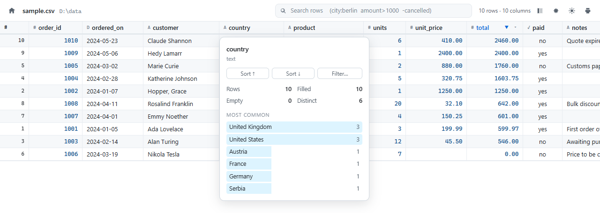

# csv.localhost

Double-click a `.csv` file in Windows Explorer and it opens as a real table,
in your default browser, at `http://csv.localhost/`.



A single ~9 MB executable with no runtime dependencies. It registers itself as
a handler for delimited text; the first double-click starts a small loopback
server in the background, every one after that reuses it, and the server shuts
itself down about half an hour after you close the last tab.

Built the same way as its sibling [md.localhost](https://github.com/boyukbas/md.localhost), and it
behaves the same: same launcher, same session model, same dark mode.

## Install

1. Build `csvlocalhost.exe` (needs [Go](https://go.dev/dl/) 1.22+):

   ```powershell
   powershell -ExecutionPolicy Bypass -File .\build.ps1
   ```

2. Register it:

   ```powershell
   powershell -ExecutionPolicy Bypass -File .\install.ps1 -StartMenu
   ```

3. Double-click any `.csv` file. `samples\sample.csv` is a good first one.

Everything is written under `HKEY_CURRENT_USER` and `%LOCALAPPDATA%`, so no
administrator rights are needed.

### Excel is still one click away

The installer adds **Open in Excel** to the right-click menu of every `.csv`,
`.tsv` and `.tab` file, so the spreadsheet is never more than one click away
when you actually want to edit. **Edit in Notepad** is there too, for looking
at the raw text.

### If Windows still opens Excel on double-click

Windows 10 and 11 deliberately stop programs from changing the *default* app
for a file type — that setting is protected by a signed `UserChoice` registry
key. Since Excel almost certainly owns `.csv` already, `install.ps1` will say
so and you finish by hand, once:

> right-click a `.csv` file → **Open with** → **Choose another app** →
> **csv.localhost** → tick **Always use this app**

### Uninstall

```powershell
powershell -ExecutionPolicy Bypass -File .\uninstall.ps1
```

## What the viewer does

- **Reads the dialect for you.** Comma, semicolon, tab, pipe and colon files
  are told apart by which one splits every line into the same number of
  fields, so a semicolon export full of commas inside its text still opens
  correctly. Excel's own `sep=;` first line is honoured and hidden. A `.tsv`
  or `.tab` is always read as tabs, whatever its contents suggest.
- **Reads the encoding for you.** UTF-8, UTF-8 with a BOM and UTF-16 are
  detected outright. A file with no marker at all — which is what Excel writes
  on a non-Unicode machine — is scored against Windows-1250, 1252, 1254 and
  ISO-8859-2, and whichever turns the high bytes into the most letters wins,
  so Polish and Turkish exports come out readable rather than full of `³` and
  `¿`. The viewer says which one it picked, and the options menu changes it.
- **Knows what each column holds.** Whole numbers, decimals, dates, yes/no
  and text are told apart per column, then numbers are right-aligned in a
  tabular font and sorted as numbers rather than as strings. `1 234,56`,
  `1,234.56`, `$1,200`, `12,50 zł`, `(250)` and `15%` are all read as the
  numbers they are.
- **Sorts by any column.** Click a heading: ascending, descending, back to
  file order. Text sorts naturally, so `item9` comes before `item10`, and
  blanks always sink to the bottom.
- **Searches as you type**, across every column or a named one:

  | Query | Finds |
  | --- | --- |
  | `berlin` | rows with "berlin" anywhere |
  | `city:berlin` | that column only |
  | `"new york"` | the phrase |
  | `amount>1000` | numeric or date comparison (`>` `<` `>=` `<=` `=` `!=`) |
  | `-cancelled` | rows that do *not* mention it |
  | `city:ber amount>500` | both conditions |

- **Summarises a column** from the `▾` on its heading: how many rows are
  filled, how many distinct values, the most common ones as a bar list, and
  for numbers the min, max, mean, median, sum, standard deviation and a small
  distribution chart. Everything is computed over the rows currently matching
  your search, not the whole file. Click one of the common values to filter to
  it.
- **Opens large files immediately.** Rows are rendered only where the window
  is, and fetched from the server in blocks as you scroll, so a 200 000-row
  file paints in about a third of a second and sorting it takes another two.
  Up to 500 000 rows are held; past that the viewer says so rather than
  eating memory.
- **Keeps its shape.** Drag a column edge to resize it (double-click to reset)
  and the width is remembered for that file. The row-number column is always
  frozen; the button in the top right freezes the first data column too.
- **Shows the whole cell.** Click any cell and the full value — not the
  clipped version in the grid — appears along the bottom with a Copy button.
  Arrow keys, Page Up/Down, Home/End move the selection; `Ctrl+C` copies it;
  `/` jumps to the search box.
- **Dark mode**, following the Windows setting by default. The button cycles
  auto → light → dark and remembers your choice.
- **Live reload.** Re-export the file and the table updates in place, keeping
  your sort, your search and your scroll position. Saving via
  write-temp-then-rename is handled.
- **Print / save as PDF**, with the chrome stripped out and up to 5 000 rows
  of the current view laid out on paper.

If a guess is wrong, the gear menu overrides it: delimiter, whether the first
row is names or data, and text encoding. Each is a real re-parse on the
server, recorded in the URL, so the page can be reloaded or bookmarked.

## Commands

`csvlocalhost.exe` is also a small CLI:

| Command | Effect |
| --- | --- |
| `csvlocalhost open <file>` | What the file association runs. Starts the server if needed. Takes `--delim` and `--no-header`. |
| `csvlocalhost home` | Open the list of recently viewed files. |
| `csvlocalhost serve` | Run the server in the foreground (`--port`, `--host`, `--idle`). |
| `csvlocalhost status` | Where the server is listening, and since when. |
| `csvlocalhost stop` | Shut the server down now. |

The binary is linked as a GUI application so double-clicking never flashes a
console window; when you run it from a terminal it reattaches to that console,
so the commands above still print normally.

## Why `csv.localhost` resolves

Chrome, Edge and Firefox all resolve any `*.localhost` name to the loopback
interface without touching DNS or the hosts file, so `http://csv.localhost/`
works out of the box. If you use a browser that does not, run the installer
with `-HostsEntry` from an elevated PowerShell to add the entry explicitly.

The server prefers port 80 so the URL stays clean. If something else already
holds it — IIS, another dev server, or md.localhost — it falls back to 8080,
then 8088, 8181, 9080, and finally any free port, and the URL gains a `:port`
suffix. Check with `csvlocalhost status`. Running both viewers at once is
fine: whichever starts first takes port 80.

## Notes on safety

A server that can read files and is reachable from the browser deserves a
little care, since any web page you have open can send requests to
`127.0.0.1`. Four things keep this one from becoming a file-exfiltration
endpoint:

- **It binds to `127.0.0.1` only.** Nothing on your network can reach it.
- **A session cookie is required.** `csvlocalhost open` mints a single-use
  key, the browser trades it for a `SameSite=Lax` `HttpOnly` cookie, and the
  key is dropped from the URL. Requests without that cookie get a 403, and
  `Lax` means another site's page cannot borrow it.
- **Only folders you opened are readable.** The folder of each file you
  double-click is added to an allow-list for the life of the server; links
  followed from a page already open extend it. A URL guessed from elsewhere
  does not.
- **The `Host` header is pinned** to `csv.localhost` / `localhost` /
  `127.0.0.1`, which blocks DNS rebinding, and cross-site requests are
  rejected outright via `Sec-Fetch-Site`.

Cell values are inserted as text, never as markup, so a CSV containing
`<script>` displays those characters rather than running anything.

Logs go to `%LOCALAPPDATA%\csv.localhost\server.log`.

## Layout

```
cmd/csvlocalhost/    CLI entry point (open, home, serve, status, stop, ...)
internal/server/     HTTP server, CSV engine, file watching, process control
  table.go           parsing: dialect sniffing, header and type inference
  decode.go          encoding detection and code-page decoding
  query.go           search clauses, sorting, cached row orderings
  stats.go           column summaries
  cache.go           parsed files, dropped when the file changes
web/                 page templates and the assets compiled into the binary
samples/             two files to try it on, one of them continental
build.ps1            builds csvlocalhost.exe
install.ps1          registers the file association
uninstall.ps1        removes it again
```

Third-party code compiled in: [fsnotify](https://github.com/fsnotify/fsnotify)
for file watching. Everything else — the CSV reader, the viewer, the charts —
is standard library and hand-written, and nothing is fetched from a CDN, so it
works offline.

Run the tests with `go test ./...`.
